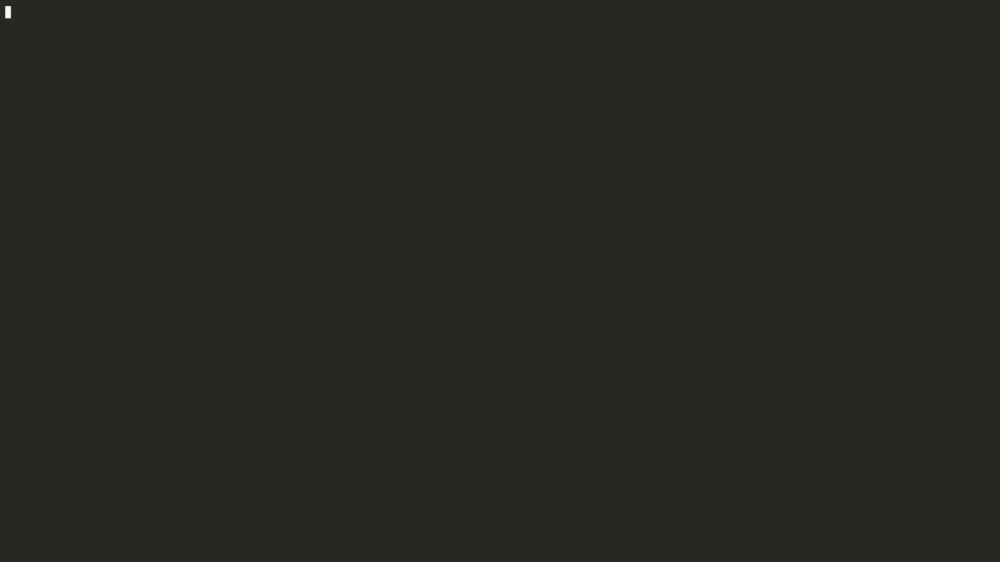
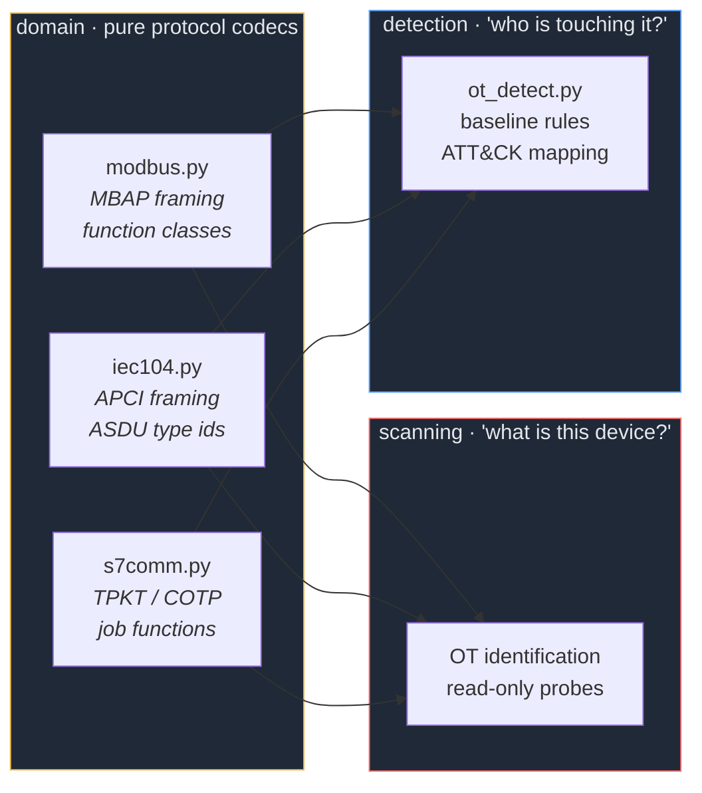
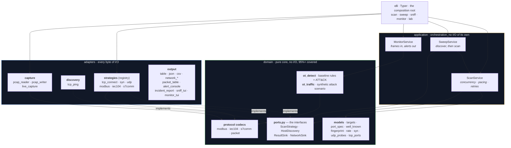
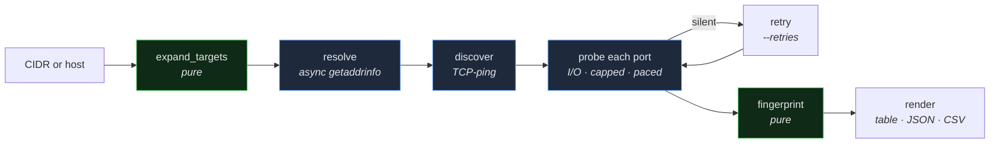
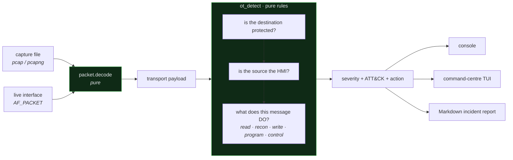
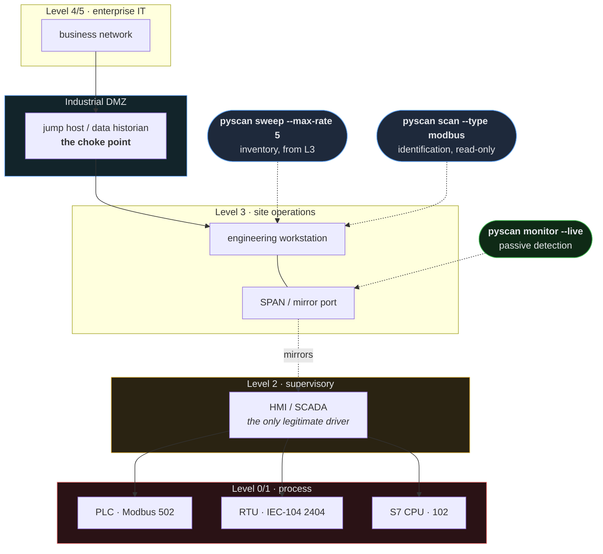

```
██████╗ ██╗   ██╗███████╗ ██████╗ █████╗ ███╗   ██╗
██╔══██╗╚██╗ ██╔╝██╔════╝██╔════╝██╔══██╗████╗  ██║
██████╔╝ ╚████╔╝ ███████╗██║     ███████║██╔██╗ ██║
██╔═══╝   ╚██╔╝  ╚════██║██║     ██╔══██║██║╚██╗██║
██║        ██║   ███████║╚██████╗██║  ██║██║ ╚████║
╚═╝        ╚═╝   ╚══════╝ ╚═════╝╚═╝  ╚═╝╚═╝  ╚═══╝
```

# pyscan

[](https://github.com/Zoel-Manchon/pyscan/actions/workflows/ci.yml)
[](https://github.com/Zoel-Manchon/pyscan/actions/workflows/codeql.yml)


**A port scanner, an OT protocol identifier, a packet sniffer and an ICS
detection engine — all hanging off one small hexagon.**



---

## At a glance

|  |  |
| --- | --- |
| **What it is** | Two products in one core. A **red-team-shaped** scanner (six techniques, five protocols, CIDR sweep) and a **blue-team-shaped** monitor (an ICS intrusion detector with ATT&CK mapping), built on the same pure protocol codecs. |
| **The one idea** | The engine never changes. A new scan technique is a new file and one `@register` line. A new output format is one interface. A whole second product — the IDS — is a new rule module over decoders that already existed. |
| **Where the line is** | Probing (I/O) is kept apart from identifying (pure logic). The domain knows nothing about sockets, files, the terminal or Typer, so every rule and every codec is testable in memory. |
| **Built with** | Python 3.11+ · asyncio · Typer · rich · Textual. scapy is optional and only for the raw SYN scan. |
| **Quality** | **255 tests**, **89% coverage** (gated in CI), `mypy --strict`, ruff, bandit, CodeQL and pip-audit on every push, across Linux, macOS and Windows. |
| **OT posture** | Read-only, and meant for simulators. On live ICS gear the scan can *be* the incident. |
| **Try it** | `pip install -e ".[dev,tui]"` then `pyscan lab capture.pcap && pyscan monitor capture.pcap --hmi 10.10.30.10` |

**Contents** — [What it does](#what-it-does) · [Quick start](#quick-start) ·
[Two products, one core](#two-products-one-core) · [Architecture](#architecture) ·
[How a scan flows](#how-a-scan-flows) · [How detection flows](#how-detection-flows) ·
[Where it sits on an OT network](#where-it-sits-on-an-ot-network) ·
[Detection rules](#detection-rules) · [Project layout](#project-layout) ·
[How to extend](#how-to-extend) · [Engineering](#engineering) ·
[Docker](#docker) · [Privileges](#privileges) · [Safety](#safety-and-legality)

---

## What it does

### Scanning

- **Async TCP connect scan** — unprivileged, concurrency-capped, fast.
- **SYN / half-open scan** — raw packets via scapy (`pip install pyscan[syn]`),
  IPv4 and IPv6, with a clear hint instead of a traceback when run without
  privileges.
- **UDP scan** — unprivileged, on asyncio datagram endpoints rather than a
  thread pool, with protocol-aware payloads (DNS, SNMP, NTP, DNP3, Modbus/UDP)
  so silent services actually answer.
- **Retries** — `--retries N` retransmits ports that stayed silent. Silence is
  not evidence: a dropped probe looks exactly like a filtered port.
- **Banner grabbing and version detection** — reads what services volunteer,
  nudges web servers with a `HEAD`, then identifies them with a pure,
  regex-driven fingerprint engine (`OpenSSH 9.6p1`, `nginx 1.24.0`, …).
- **Host discovery and CIDR sweep** — TCP-ping a range, then inventory the
  hosts that answered. `--max-rate` caps probes per second across the **whole
  sweep**, not per host.
- **IPv4 and IPv6 throughout**, with non-blocking DNS resolution.

### OT / ICS identification — read-only, simulators only

- **Modbus/TCP** — vendor / product / firmware, via the device-ID object.
- **IEC 60870-5-104** — liveness, via a TESTFR keepalive.
- **S7comm** — module order number (MLFB), via an SZL read.

### Capture and detection

- **Packet sniffer** — decodes **pcap and pcapng** (Wireshark's default format),
  classic captures in either byte order and at microsecond or nanosecond
  resolution, streaming so a multi-gigabyte capture does not become
  multi-gigabyte memory. Ethernet, 802.1Q, Linux cooked capture, IPv4, IPv6 with
  extension headers, TCP, UDP, ICMP, ICMPv6, ARP.
- **OT intrusion detection** — `pyscan monitor` watches Modbus, IEC-104 and
  S7comm traffic against a baseline of who is allowed to drive the process, and
  raises severity-rated alerts mapped to MITRE ATT&CK for ICS, each with the
  action a responder should actually take.
- **Two TUIs** — a live scrolling packet view, and an OT command centre with an
  evidence timeline and a one-keystroke Markdown incident report.
- **A practice lab** — `pyscan lab` writes a capture with a full attack inside
  it, built from the standard library alone.

---

## Quick start

```bash
pip install -e ".[dev,tui]"     # or: make dev
pytest -q                        # 255 passing, 89% covered
```

### The offline demo — no network, no privileges, sixty seconds

```bash
pyscan lab capture.pcap                       # a capture with an attack inside
pyscan monitor capture.pcap \
    --hmi 10.10.30.10 --plc 10.10.30.21,10.10.40.7
```

```
[  MEDIUM] 22:13:26  10.10.30.142 -> 10.10.30.21     Modbus  New connection (SYN) to OT port 502
           ATT&CK: T0846 Remote System Discovery
           Action: Unexpected talker reaching OT. Watch it: this is the prelude.
[  MEDIUM] 22:13:27  10.10.30.142 -> 10.10.30.21     Modbus  Reconnaissance - FC43 Read Device Identification
           ATT&CK: T0888 Remote System Information Discovery
           Action: Enumeration usually precedes the write. Track this source now.
[CRITICAL] 22:13:30  10.10.30.142 -> 10.10.30.21     Modbus  WRITE to the process - FC6 Write Single Register
           ATT&CK: T0855 Unauthorized Command Message / T0836 Modify Parameter
           Action: Confirm the source is not the HMI, then isolate it. Do NOT reboot the PLC.
[CRITICAL] 22:13:33  10.10.30.142 -> 10.10.40.7      IEC-104  CONTROL COMMAND - C_SC_NA single command
           ATT&CK: T0855 Unauthorized Command Message
           Action: A legitimate command from an illegitimate source is the Industroyer signature.
```

Then open the command centre over the same capture:

```bash
pyscan monitor capture.pcap --tui
```

### Scanning

```bash
pyscan scan scanme.nmap.org -p 22,80,443           # connect scan + banners + version
pyscan scan scanme.nmap.org --top-ports 100        # the 100 most common ports
pyscan scan scanme.nmap.org -p 1-1024 --csv out.csv
pyscan scan scanme.nmap.org -p 22,80 --retries 2   # retransmit silent ports
pyscan scan example.com -p 443 --ipv6              # prefer the AAAA record

pyscan scan scanme.nmap.org -p 22,80,443 --type syn       # half-open (needs root/Npcap)
pyscan scan 8.8.8.8        -p 53,123     --type udp --all # UDP with protocol-aware probes
```

### Sweeping a network

```bash
pyscan sweep 192.168.1.0/24
pyscan sweep 192.168.1.0/24 --detail               # + per-host port tables
pyscan sweep 10.0.0.0/28 --json net.json           # machine-readable inventory
pyscan sweep 10.10.30.0/24 --max-rate 5            # 5 probes/sec across the whole sweep
```

### OT identification — simulators and lab gear only

```bash
pyscan scan 127.0.0.1 -p 502  --type modbus  --max-rate 5
pyscan scan 127.0.0.1 -p 2404 --type iec104
pyscan scan 127.0.0.1 -p 102  --type s7comm
```

### Capture and monitoring

```bash
pyscan sniff capture.pcapng                        # pcap or pcapng
pyscan sniff capture.pcapng --proto tcp --count 50
pyscan sniff capture.pcapng --tui
sudo pyscan sniff --live --iface eth0 --tui        # live capture (Linux, root)

pyscan monitor capture.pcapng --hmi 10.10.30.10 --report incident.md
sudo pyscan monitor --live --iface eth0 --tui      # the command centre, live
```

> **Only use this on hosts you own or are authorised to test.**
> `scanme.nmap.org` exists precisely for practice.

### A Modbus target to scan

`tools/modbus_sim.py` is a self-contained Modbus/TCP simulator — a fake
energy-substation RTU — so the OT scanner has something real to identify.

```bash
pip install -e ".[lab]"                            # installs pymodbus
python tools/modbus_sim.py                         # listens on 127.0.0.1:5020
pyscan scan 127.0.0.1 -p 5020 --type modbus        # -> pyscan-lab VPLC-01 1.4.2
```

---

## Two products, one core

The interesting claim of this repository is not that it scans ports. It is that
a **scanner** and an **intrusion detector** — opposite ends of the same trade —
turn out to need the same knowledge, and here they share it rather than each
keeping their own copy.



`modbus.classify_function(0x05)` returns `WRITE` whether the caller is the
scanner deciding what is safe to send, or the detector deciding whether to wake
somebody up. One definition of what a Modbus write is. Fix it once, and both
products are fixed.

The same holds one layer down: the detection engine reads captures through
pyscan's own pure `pcap_reader` and `packet.decode`, and the practice capture is
written by pyscan's own `pcap_writer`. **The entire OT toolkit runs on the
standard library** — no packet library at all, except for the optional raw SYN
scan.

---

## Architecture

Dependencies point **inward**. The domain knows nothing about sockets, files,
the terminal or Typer. Adapters depend on the domain's interfaces, never the
reverse — so anything on the outer ring is replaceable in isolation.



The rule that makes it work: **an arrow may never point outward from the domain.**
`ot_detect.py` imports `modbus.py`; neither has ever heard of a socket. That is
why 132 lines of detection rules can be tested exhaustively without a PLC.

---

## How a scan flows

Probing (I/O) is separated from identifying (pure logic), so each stage is
testable and replaceable on its own.



Three knobs govern how hard it pushes, and they compose:
`--concurrency` (how many probes are in flight), `--max-rate` (how many start
per second, shared across an entire sweep), and `--retries` (how many times a
silence is questioned before it is believed).

---

## How detection flows

The same pipeline runs whether the frames come off a wire or out of a file,
which is the point: the code path used during an exercise is the one that was
exercised against a capture.



Severity is a function of two things — **what the message does**, and **whether
the source is the station that is supposed to be doing it**. A `Write Single
Coil` from the HMI is a Tuesday. The identical frame from an engineering laptop
that has never spoken to that PLC before is an incident.

---

## Where it sits on an OT network

The Purdue model, and where each command belongs. The short version: **scan from
above the line, listen from beside it.**



`monitor` is entirely passive — it reads a mirrored copy of traffic and never
transmits, so it is the only one of the three that is safe to point at Level 0/1
during production. `scan` and `sweep` transmit, so they belong at Level 3,
throttled, against equipment you have written authorisation to touch.

**Baseline first.** The detector is only as good as the answer to "which station
is the HMI?", and that question is answered by watching, not by scanning.

---

## Detection rules

| What is seen | Severity | ATT&CK for ICS | The reasoning |
| --- | --- | --- | --- |
| SYN to an OT port from an unknown source | MEDIUM | T0846 Remote System Discovery | A new talker is the prelude |
| Any OT payload from an unknown source | HIGH | T0846 Remote System Discovery | Reported once per source/target pair |
| Modbus FC 8 / 17 / 43 (recon) | MEDIUM | T0888 Remote System Information Discovery | Enumeration precedes the write |
| IEC-104 interrogation (C_IC / C_CI) | MEDIUM | T0888 | Same shape, different protocol |
| **Modbus write** (FC 5 / 6 / 15 / 16 / 22 / 23) | **CRITICAL** | T0855 Unauthorized Command Message · T0836 Modify Parameter | Something moved in the plant |
| **IEC-104 control command** (C_SC / C_DC / C_SE …) | **CRITICAL** | T0855 | The Industroyer signature |
| **S7 write / block download / CPU stop** | **CRITICAL** | T0855 · T0843 Program Download · T0858 Change Operating Mode | The logic itself is being changed |
| IEC-104 STOPDT act | MEDIUM | T0804 Block Reporting Message | Telemetry is being silenced |

Two behaviours are worth spelling out:

* **A write from the HMI is logged at INFO, not suppressed.** It is normal
  operation — but a compromised HMI is a real scenario, and a rule that cannot
  see the legitimate station is blind to the worst case.
* **With no baseline configured, a write is HIGH, never CRITICAL.** The tool
  will not call a source hostile when it has not been told who is friendly.
  With no PLC list, every OT destination is treated as protected, so it is
  useful before you have finished mapping the site.

---

## Project layout

```
src/pyscan/
├── domain/                    pure core — no I/O, unit-tested exhaustively
│   ├── models.py                  value objects · ScanReport · NetworkReport
│   ├── ports.py                   the 4 interfaces (the hexagon boundary)
│   ├── targets.py                 CIDR / IP / host expansion, v4 and v6
│   ├── port_spec.py               "1-1024,8080" parser
│   ├── well_known.py              port -> service map
│   ├── fingerprint.py             banner -> service / product / version
│   ├── top_ports.py               nmap-style frequency ordering
│   ├── rate.py                    the pacing maths (clock-injected)
│   ├── syn.py                     SYN response -> PortState
│   ├── udp_probes.py              protocol-aware UDP payloads
│   ├── packet.py                  Ethernet · VLAN · SLL · IPv4/IPv6 · TCP/UDP/ICMP
│   ├── modbus.py                  MBAP codec + function classification
│   ├── iec104.py                  APCI/ASDU codec + type-id classification
│   ├── s7comm.py                  TPKT/COTP/S7 codec + job classification
│   ├── ot_detect.py               ★ the detection rules
│   └── ot_traffic.py              ★ synthetic attack scenario, byte for byte
├── application/                orchestration, still no I/O of its own
│   ├── scan_service.py            single host: concurrency, pacing, retries
│   ├── sweep_service.py           discovery + per-host scan + inventory
│   ├── monitor_service.py         ★ frames -> decode -> rules -> alerts
│   └── rate_limiter.py            the async gate around the pure pacer
├── adapters/                   every byte of I/O lives here
│   ├── strategies/                tcp_connect · syn · udp · modbus · iec104 · s7comm
│   ├── discovery/                 tcp_ping
│   ├── capture/                   pcap_reader (pcap + pcapng) · pcap_writer · live_capture
│   └── output/                    table · json · csv · network_* · packet_table
│                                  alert_console · incident_report · sniff_tui · monitor_tui
└── cli/                        main (Typer) · banner
```

---

## How to extend

| Want to add… | Do this | Touches the engine? |
| --- | --- | --- |
| A scan technique (FIN, Xmas, ACK) | new file in `adapters/strategies/`, one `@register("name")` | no |
| A new OT protocol | pure codec in `domain/`, thin strategy in `adapters/strategies/` | no |
| A detection rule | one method in `domain/ot_detect.py` | no |
| An output format (SQLite, syslog) | implement `ResultSink` / `NetworkSink` | no |
| A discovery method (ICMP, ARP) | implement `HostDiscovery` | no |
| Detection for a new product | one regex row in `fingerprint.py` | no |
| A new capture container | one reader yielding `(ts, linktype, bytes)` | no |

---

## Engineering

Every push and pull request runs the full set:

| Gate | Tool | Enforcing |
| --- | --- | --- |
| Lint | ruff (`E,F,I,UP,B,SIM,C4`) | style, bug patterns, modern idiom |
| Types | **mypy `--strict`** | the whole `src/` tree, no escapes |
| Tests | pytest | **255 tests**, Linux · macOS · Windows, Python 3.11 / 3.12 / 3.13 |
| Coverage | pytest-cov | **89%**, gated — the build fails below 85% |
| Static analysis | bandit | insecure API use |
| Semantic analysis | CodeQL | injection and taint flow, weekly as well as per-push |
| Dependencies | pip-audit | known CVEs |
| Packaging | build + twine | the wheel installs and the CLI runs |
| Container | docker build | the image builds and runs |
| Updates | Dependabot | pip, GitHub Actions, Docker base image |

Locally, `make check` runs all of it. `pre-commit install` moves the same gates
to the moment before a commit exists.

The coverage number is deliberately not 100%. Three modules are excluded and
named in `pyproject.toml`: the two Textual views and the AF_PACKET capture loop,
none of which can run without a TTY or root. They are kept thin precisely so
that the untested surface stays small and obvious — all three together hold no
branching logic worth the name.

---

## Docker

```bash
docker build -t pyscan .
docker run --rm pyscan scan scanme.nmap.org -p 22,80,443
docker run --rm -v "$PWD:/data" -w /data pyscan monitor capture.pcapng --hmi 10.10.30.10
```

For the full exercise kit — pyscan with every extra, plus tshark and nmap,
driven by a menu:

```bash
./otkit.sh          # or: make menu
```

See [DOCKER.md](DOCKER.md) for the whole story, including why the compose file
asks for `network_mode: host` and `NET_RAW`.

---

## Privileges

| Feature | Needs root? |
| --- | --- |
| TCP connect scan, UDP scan, TCP-ping discovery | no |
| Reading a pcap / pcapng, replaying it through the detector | no |
| OT identification (Modbus, IEC-104, S7comm) | no |
| SYN / half-open scan | **yes** — raw sockets |
| Live capture (`--live`) | **yes** — Linux AF_PACKET |

That is the operating system gating raw sockets, not Python. On Windows the
privileged paths want admin plus Npcap, or WSL2. pyscan prints a clear hint
instead of a traceback when it lacks what it needs.

---

## Safety and legality

Use this only against systems you own or have written authorisation to test.
Unsolicited scanning of third-party networks is illegal in many jurisdictions.

**It deliberately cannot write to an OT device.** Identification is read-only by
design, and the code to write a coil, issue a control command or stop a CPU is
not in this repository. The difference between reading a device ID and writing a
coil is the difference between an audit and an outage.

When you must touch real equipment: throttle it (`--max-rate 5`), prefer a
simulator, and remember that on live ICS gear the scan itself can be the
incident. See [SECURITY.md](SECURITY.md).

---

## License

MIT — see [LICENSE](LICENSE).
